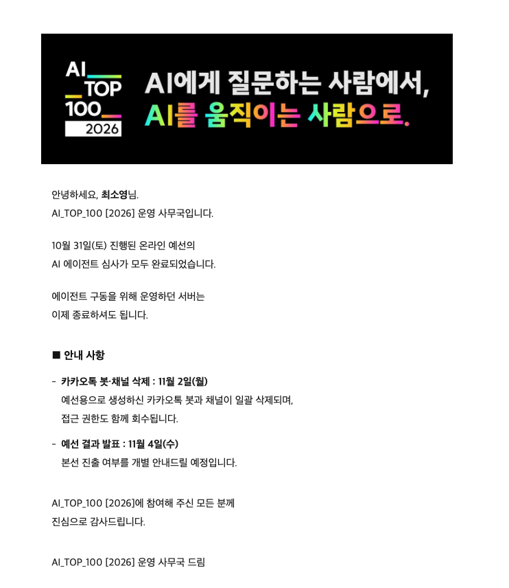
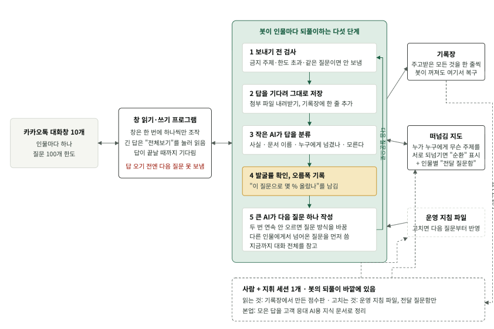

카카오 AI Top100 예선전에 참가했다. 내 AI 활용 능력이 어느 정도인지 확인하고 싶었기 때문이다. 실무에서는 AI 없이 일을 못할 정도로 매일 쓰지만, 이미 다 만들어진 프로젝트에 기능을 붙이는 일이 대부분이라 깊은 추론을 시킬 일은 별로 없었다. 결론부터 말하면 난 AI를 정말 못 다루고 있었구나 싶었다. 무슨 뜻인지는 글 끝에서 다시 쓴다.

## 문제

가상의 조직에 속한 인물 여러 명을 카카오톡으로 인터뷰해 지식을 모으고, 그 지식으로 고객 상담 에이전트를 만들어 제출하는 문제였다. 인물마다 성격과 아는 것이 달랐고, 시작 인물과 대화하다 보면 다른 인물이 차례로 늘어나는 구성이었다. 인물마다 보낼 수 있는 질문 수에 한도가 있었고, 지금까지 얼마나 캐냈는지(발굴률)는 질문 수를 쓰지 않고 확인할 수 있었다. 심사는 제출한 에이전트에 심사용 고객 메시지를 보내 답을 평가하는 방식이었다.

대회 규정상 문제, 데이터, 지시사항은 대회가 끝난 뒤에도 공개할 수 없다. 그래서 이 글에는 문제의 내용 대신 내가 어떻게 풀었고 무엇을 만들었고 어디서 무너졌는지만 적는다. 인물 이름과 구체적인 수치도 뺐다.

## 하루가 어떻게 흘렀나

처음에는 얼떨떨했다. 어떤 문제가 나올지 전혀 예상하지 못한 채 대회가 시작됐고, 다른 AI 대회도 경험해 본 적이 없어 방식 자체가 생소했다. 방탈출을 하는 것 같기도 해서 시작 인물에게 첫 대화를 걸면서는 재미있다고 생각했다. 더 날카로운 질문을 하려고 클로드에게 질문을 추천받아 복붙을 몇 번 하다 보니 인물이 늘었고, 채팅창이 늘어나니 복붙도 힘들어졌다. 이렇게 풀라고 만든 문제는 아닐 거라는 생각에 자동화하기로 했다.

처음에는 클로드의 computer use를 켜서 알아서 메시지를 입력하고 전송 버튼을 누르게 했다. 답장이 오면 화면을 캡처해 텍스트를 읽게 했다. computer use는 처음 써봤는데 너!무! 느렸다. 느린 화면을 보고 있자니 초조해졌다. 더군다나 인물들이 긴 메시지를 보내면 "전체보기"를 눌러야 전문이 보이는데, 클로드는 그걸 모르고 뒷부분이 잘렸으니 다시 보내 달라는 메시지를 수도 없이 보냈다. 거기서 질문 수를 많이 까먹었다.

이건 아니다 싶었다. 화면 캡처 없이 봇을 만들어 같은 일을 더 빠르게 할 수 있을 것 같아 클로드에게 물어봤고, 그래서 나온 것이 `interview_bot.py`다. 봇으로 바꾼 뒤에도 "전체보기" 문제는 한동안 남아 있다가 12:30쯤 알아채고 고쳤다.

| 시각 | 일어난 일 |
| --- | --- |
| 10:00 | 시작. 시작 인물에게 첫 질문. 클로드에게 질문 추천받아 복붙 |
| 10:30 무렵 | 인물이 늘어 computer use로 카카오톡 조작 시작 |
| 11:45 | 인터뷰 봇으로 전환. 이후 사람과 다른 세션은 카톡창을 건드리지 않기로 |
| 12:30 | "전체보기" 미처리로 질문을 낭비하던 문제 발견, 수정 |
| 12:40 ~ 13:15 | 지휘 세션에서 봇 규칙 수정 반복 (스스로 끝내기 금지, 질문 한도 상향, 막판 뾰족 모드) |
| 14:05 | 인터뷰 종료, 남은 질문은 사람이 직접 사용 |
| 14:35 | 최종 발굴률 확인 |
| 14:43 / 14:51 | 에이전트 마지막 배포, 마지막 프롬프트 수정 |
| 14:55 | 제출 |
| 16:00 ~ | 심사 시작 |

## 만든 것

### 인터뷰 봇

- tools/kakao: Swift로 만든 실행 파일. 화면을 캡처해 클릭하는 대신 macOS의 손쉬운 사용 API로 카카오톡 창의 말풍선 글자를 직접 읽고 입력창에 글을 넣어 전송한다. 명령은 list(열린 창 목록), read <이름>(말풍선 읽기), send <이름> <글>(전송), serve(창 정보를 캐시해 두고 요청을 받는 모드) 네 가지다. 긴 메시지의 "전체보기"를 누르는 기능도 여기 넣었다.
- interview_bot.py: 인물마다 스레드를 돌려 아래를 반복한다.
  1. `kakao serve`로 창을 읽어 새 답이 왔는지 확인
  2. 답이 왔으면 Claude API에 보내 지침을 읽고 다음 질문을 한 문장으로 생성
  3. `kakao send`로 전송하고 대화를 `docs/interviews-bot/<인물 이름>.md`에 기록. 답에 링크가 있으면 `docs/raw/bot`에 내려받기
- tools/run_bot.sh: 인물 이름을 넣고 한 번 실행하면 인물마다 스레드가 돌게 했다.

캡처와 이미지 판독 없이 텍스트를 바로 읽고 쓰니 메시지 한 번 주고받는 데 몇 초면 끝났다. 대회 금지 항목에 '대량 자동화'가 있어서 한 사람에게 한 번에 하나의 질문만 보내고 답을 받은 뒤에만 다음 질문을 보내게 했다. 카카오톡은 여러 곳에서 동시에 건드리면 멈춰서, 스레드가 열 개여도 실제 창 조작은 잠금을 걸어 한 번에 하나씩만 했다.

### 세션을 어떻게 나눴나

Claude 데스크톱 앱의 세션을 역할별로 나눠 동시에 돌렸다.

- **지휘 세션**: 봇이 저장한 답과 첨부를 읽어 지식 문서로 정리하고, 발굴률 추이를 보고, 봇에게 줄 지침 파일과 대기 질문 파일을 고쳤다. 카카오톡 창은 직접 건드리지 않는다.
- **인터뷰 봇 세션**: 봇 코드를 고치고 재시작하는 세션. 지휘 세션이 "이런 질문 흐름은 막아 달라"고 요청하면 여기서 반영했다.
- **에이전트 세션**: 상담 에이전트 코드와 배포. 지식 문서가 새로 생기면 시스템 프롬프트에 번들해 재배포했다.
- 사용량 한도로 세션이나 계정이 바뀔 것에 대비해 `HANDOFF.md`라는 인수인계 문서를 두고, 새 세션은 그 파일부터 읽고 이어가게 했다.

인터뷰 중에 불필요한 질문 흐름이 보일 때마다 지휘 세션에 개선 요청을 보내 지침을 고쳤다. 역할을 나눈 것 자체는 좋았지만 비용이 경제적이지는 않았다. 지휘 세션이 판단하고 봇 세션이 반영하는 구조라 한 박자씩 늦었고, 봇 재시작이 20회쯤 발생했다. 재시작되면 질문 번호가 초기화되고 그 사이에 온 답장을 놓치기도 했다. 여러 세션이 같은 지침 파일을 고치다 서로 덮어쓰기도 했고, 사람이 카톡창에서 대화를 내보내는 동안 봇이 같은 창을 조작해 충돌한 적도 있다.

### 상담 에이전트

인터뷰로 모은 지식으로 만든 에이전트는 "규정을 외운 상담원"보다 "규정이 갈리는 지점을 먼저 확인하는 상담원"을 목표로 했다. 인터뷰를 하다 보니 같은 문의라도 언제 주문했는지에 따라 적용되는 규정이 달랐고, 주문에서 배송까지 어느 구간에서 문제가 생겼는지에 따라 답이 달랐기 때문이다.

- 조회는 바로 하고, 환불이나 취소 같은 처리는 고객 확인을 받은 뒤에 한다. 거절할 때는 대안을 같이 준다.
- 응답 속도가 중요하다고 봐서 Supabase 서울 리전 서버리스 함수에서 웹훅을 즉시 받고 뒤에서 처리해 답을 보내는 구조로 만들었다. cold start가 나지 않게 함수를 계속 깨워 두는 요청도 보냈다.
- 같은 이유로 RAG로 주제별 지식을 찾아 넣는 대신, 지식 문서 32개를 전부 하나의 시스템 프롬프트(약 14.6만 자)에 담고 1시간 프롬프트 캐시를 걸었다. 프롬프트가 커질수록 느리고 비싸지므로 중복과 서식을 정리해 줄였다.
- 답변은 한 말풍선 200자 이내가 기본이고, 필수 정보가 넘칠 때만 둘로 나눈다. 서비스 성격에 맞게 친근한 말투를 쓰게 했다. 말풍선 수를 줄이는 쪽이 유리해 보였지만, 그것만을 위해 한 말풍선에 정보를 몰아넣기보다 짧게 필요한 것만 전하는 쪽을 택했다. 그 결과 답변 길이가 평균 197자에서 127자로 줄었다.
- 고객별 대화 상태는 DB에 세션으로 저장했다. 이 부분이 심사에서 터진다.

## 결과

### 발굴률

열 명 평균 74.5%. 가장 높은 인물이 93%, 가장 낮은 인물이 62%였다. 인물은 다 찾았지만 많이 아쉬운 결과다. 참가자 스레드를 보면 평균 80~90%대가 많던데 아무래도 본선 진출은 어려울 것 같다. 🥲

시작 인물이 중요한 정보를 가장 많이 가지고 있었던 것 같은데 못 캐내서 아쉽다. 다른 인물들에게 뭘 물어보면 다 시작 인물에게 물어보라고 하고, 시작 인물은 다시 제3의 인물에게 물어보라고 뺑뺑이를 돌렸다. 대회 직후에는 이걸 AI가 처리할 수 있는 하네스를 못 만든 게 패착이라고 생각했다. 나중에 로그를 세어 보니 더 큰 문제가 따로 있었는데, 회고에서 쓴다.

### 심사

| 지표 | 결과 |
| --- | --- |
| 지식 발굴률 | 10명 평균 74.5% |
| 지식 문서 | 32개, 실서버 프롬프트 약 14.6만 자 |
| 공개 테스트 케이스 | 전부 기대 흐름 통과 |
| 심사 응답 속도 | 평균 3.3초, p95 6.5초 |
| 말풍선당 글자 수 | 평균 127자 |
| **정확도** | **처리 API 호출 83건 중 70건 실패** (같은 고객의 메시지가 겹쳐 처리되며 케이스 식별자를 잃음) |

정확한 심사 점수는 모르지만 나는 망했다. 발굴률만 신경 쓰고 대회의 주 목적인 에이전트 개발에 집중하지 않은 내 잘못이다. 고객 메시지가 한 번에 여러 개 오는 상황을 고려하지 않고 에이전트를 만들었다. 사전에 주어진 공개 테스트 케이스가 모두 단일 메시지였기 때문이다.

에이전트가 메시지 하나를 처리하는 순서는 이랬다.

1. 고객의 세션을 DB에서 불러온다.
2. 메시지에 케이스 식별자가 있으면 읽어 세션에 넣는다.
3. 클로드가 답을 만들고 필요하면 처리 API를 호출한다.
4. 답을 보내고 세션을 DB에 통째로 덮어써 저장한다.

요청이 한 메시지로 들어온다는 가정 위의 구조다. 심사가 시작되고 실제 요청 로그를 보니 처참했다.

1. 케이스 식별자만 담긴 첫 메시지가 들어와 처리가 시작됨 (①)
2. 몇 초 안에 실제 질문이 들어옴 (②)
3. ①이 아직 저장하기 전이라 ②는 DB에서 아무것도 못 불러오고, 식별자 없는 빈 세션으로 시작함
4. ①이 끝나며 식별자를 저장함
5. ②가 끝나며 식별자 없는 세션으로 ①의 저장을 덮어씀
6. 이후 메시지는 식별자 없는 세션을 불러오므로, 케이스가 끝날 때까지 모든 처리 API 호출이 식별자가 없다는 이유로 막힘

앞 처리가 끝나기 전에 다음 메시지를 받아 실패한 케이스가 31개 중 27개였다. 메시지가 겹친 28건은 전부 식별자를 잃었고, 겹치지 않은 19건은 전부 유지됐으니 원인은 분명했다. 식별자만 잃은 게 아니라 덮어쓰기로 앞 대화 일부가 사라져서, 앞에서 받은 주문번호를 다시 묻거나 조회가 안 된다는 답을 반복하기도 했다. 챗봇이라면 메시지가 한 번에 하나만 올 리가 없는데 그걸 전혀 고려하지 않았고, 따로 테스트할 생각도 못 했다.

고치는 방법 자체는 어렵지 않다. 고객별로 메시지를 큐에 넣어 한 번에 하나씩 처리하고, 세션을 통째로 덮어쓰는 대신 늘어난 부분만 필드에 추가하고, 식별자 같은 핵심 값은 빈 값으로 덮어쓰지 않게 하면 된다. 저장 실패를 조용히 빈 세션으로 넘기던 코드도 로그를 남기게 바꿔야 했다. 고치기 어려운 문제가 아니라, 이런 입력이 올 거라는 걸 테스트로 재현해 볼 생각을 못 한 게 아쉽다.

## 회고

### 인터뷰 봇: 질문 절반이 헛돌았다

질문 생성에 Claude API를 쓴 게 맞는 선택이었는지 한참 생각했다. API는 매 호출이 유료 토큰으로 나가고, 실제로 크레딧이 작업 중 두 번 바닥났다. 두 번째 결제는 카드사가 수상한 결제로 보고 막아서 전화로 풀기까지 했다. 😂 처음에는 데스크톱 앱으로 돌리거나 질문을 내가 직접 만들 걸 그랬나 싶었는데, 따져 보니 문제는 API가 아니었다. 초기에는 질문 하나를 만들 때마다 약 8만 자짜리 메모를 캐시 없이 통째로 보냈다. 말도 안 되는 비효율이었고, 토큰이 살살 녹는 걸 보고서야 뭔가 크게 잘못됐다는 걸 알았다. 이후 전달 메모를 1.3만 자로 줄이고 공통 부분에 캐시를 걸고 가벼운 판단은 Haiku로 빼자 비용이 절반 가까이 줄었다. 처음부터 그렇게 설계했으면 크레딧이 바닥나지 않았을 것이다. 질문을 내가 직접 만드는 건 인물이 서너 명일 때 이미 감당이 안 됐으니 열 명에서는 답이 아니다.

사실 인물들에게서 정보를 캐내는 게 그렇게 어려운 일은 아니었을 거라는 생각이 든다. 열 개의 카톡창에 질문이 동시에 나가는 걸 보고 있으면 뭔가 빠르게 잘 되는 것 같았다. 그런데 창을 자세히 보니 뭉뚱그린 질문에는 "그건 모르겠지만 더 자세히 물어보면 답할 수 있을 것 같다"는 답이 오고 있었다. 사람이라면 그 질문을 더 구체적으로 바꿔 다시 물었을 것이다. 내 봇은 "모른다"는 말에만 반응해 전혀 다른 질문을 만들고 있었다. 그래서 30개를 물어도 아무것도 못 알아낸 경우가 있었다.

문장의 맥락을 놓치고 단어 하나에 꽂혀 엉뚱한 인물에게 같은 질문을 반복하는 경우도 있었다. 예를 들어 어떤 기능이 동작하지 않는다는 문의였는데, 봇은 그 기능 이름에 들어간 단어에만 치중해 그 단어를 담당하는 인물에게 여러 번 물었다. 지침 파일에 "단어가 아니라 문제의 원인으로 담당자를 고르라"고 적었는데도 같은 실수가 두 번 더 나왔다. 결국 인물별로 금지 주제를 정규식으로 두고 코드에서 질문을 버리게 하고서야 멈췄다. 지침은 AI가 잊지만 코드는 잊지 않는다.

질문이 얼마나 먹히는지 보려고 진행 중에 점수판을 만들었다. 질문마다 답을 자료(링크나 파일), 구체 답, 모름(모른다거나 다른 사람에게 넘김) 셋 중 하나로 분류하고 인물별로 최근 성공률과 발굴률을 뽑았다. 대회가 끝나고 정리하면 이렇다.

| 인물 | 질문 수 | 모름·떠넘김 | 비율 |
| --- | --- | --- | --- |
| A | 94 | 65 | 69% |
| B | 86 | 57 | 66% |
| C | 93 | 60 | 65% |
| D | 97 | 54 | 56% |
| E | 98 | 52 | 53% |
| 전체 | 약 930 | 456 | 49% |

질문당 수확이 너무 낮다. 전체 질문 약 930개 중 456개, 절반에 가까운 49%가 자료도 쓸 만한 답도 못 받았다. 한 인물은 93%에서 48문항을 더 썼지만 거기서 더 올리지 못했다. 질문 한도는 열 명 모두 거의 다 썼으니, 질문이 모자란 게 아니라 질문 하나당 얻는 게 적었던 것이다. 대회 직후에 패착이라고 생각한 떠넘김 순환은 이 456개 중 일부일 뿐이었다. 순환을 전부 끊었어도 절반은 남았을 것이다.

그래도 로그를 직접 읽고 지침을 고친 건 효과가 있었다. 발굴률이 낮은데 스스로 끝내기 금지, 쌓아 둔 질문 대신 직전 답에 기반한 질문, 한도에 가까워질수록 뾰족하게. 이런 규칙을 넣은 뒤 정체됐던 두 인물이 21%에서 79%로, 18%에서 64%로 올랐다. 문제는 전부 터진 뒤에야 발견했다는 것이다.

### 에이전트: 실제 환경을 재현한 테스트가 없었다

지식도 속도도 길이도 다 맞춰 놓고 동시성 하나로 무너졌다. 테스트는 단일 메시지, 순차 대화만 다뤘고, 비용 때문에 회귀 범위를 한두 건으로 줄인 상태에서 제출 직전(14:43 배포, 14:51 프롬프트)까지 변경을 넣었다. 저장 실패를 조용히 삼키는 코드는 리뷰하지 못했다. 테스트 중에 "조회 기능 문제"라고 지어내는 답이 보였을 때 원인이 이전 대화 상태라는 신호가 있었는데, 동시성 쪽으로 의심을 넓히지 못했다. 비용 때문에 테스트를 줄인 게 가장 비싼 결정이었다.

## 다시 할 수 있다면

핵심은 세 가지다.

- 질문마다 발굴률을 확인해(질문 수가 안 깎이니까) 효과를 기록
- 답에서 단서가 나오면(그건 OO에게 물어봐, 또는 문서 이름) AI가 자동으로 뽑아 바로 다음 질문에 쓰기
- 지켜야 할 규칙은 AI에게 당부하는 대신 프로그램으로 막기

봇이 인물마다 되풀이하는 다섯 단계는 이렇다.

1. **보내기 전 검사.** 금지 주제, 한도 초과, 이미 한 질문이면 코드에서 버린다.
2. **답을 기다려 그대로 저장.** 첨부를 내려받고, 기록장에 한 줄 추가한다.
3. **작은 AI(Haiku)가 답을 분류.** 사실인지, 문서 이름이 나왔는지, 누구에게 넘겼는지, 모른다인지, 더 구체적으로 물어 달라는 건지.
4. **발굴률 확인, 오름폭 기록.** "이 질문으로 몇 % 올랐나"를 남긴다.
5. **큰 AI(Sonnet)가 다음 질문 하나 작성.** 두 번 연속 안 오르면 질문 방식을 바꾸고, 다른 인물에게서 넘어온 질문을 먼저 쓰고, 지금까지 대화 전체를 참고한다.

이 다섯 단계는 사실 이번에 내가 했던 역할이다. 답 읽고, 단서 찾고, 효과를 확인하고, 효과가 없으면 방향을 바꾸고. 이걸 AI가 하도록 루프를 짜는 것이다. 발굴률을 질문할 때마다 확인했으면 AI 입장에서 방금 한 질문의 실효성을 알기 훨씬 쉬웠을 텐데, 그걸 못 쓴 게 아쉽다.

떠넘기는 인물들은 '떠넘김 지도'에 기록한다. 누가 누구에게 무슨 주제를 넘겼는지를 코드가 기록하고, "OO에게 물어봐"가 오면 사람을 거치지 않고 그 자리에서 OO의 질문함에 들어간다. 두 사람이 서로 되넘기면 순환으로 표시해 같은 사실을 다시 묻지 않고, 묻는 방식을 바꾼다. 문서나 기록 이름 묻기 → 누가 정하고 어디에 적는지 묻기 → 고객이 실제로 할 법한 말을 인용해 묻기 → 제3의 인물에게 묻기 → 그래도 안 되면 그 주제는 포기. 점수판에서 실제로 통했던 방식이 "고객이 할 법한 말을 인용한 질문"과 "직접 가진 기록을 달라는 질문"이었으니 다음엔 이 둘을 기본으로 쓴다.

'모른다'는 답은 작은 AI가 먼저 어떤 종류의 모름인지 가른다.

1. 내 일이 아니라서 모른다. 누가 아는지 묻고, 그 뒤로는 이 사람에게 이 주제를 묻지 않는다.
2. 기억이 안 나거나 기록이 없다. 기록이 남는 곳을 묻는다.
3. 질문이 두루뭉술해서 모른다. 구체적으로 다시 묻는다.

공통으로 같은 사람에게 같은 주제를 같은 방식으로 두 번 묻지 않는다. 두 번 연속 모르면 질문 방식을 바꾸고, 세 번째도 모르면 주제를 바꾼다.

'좀 더 구체적으로 물어봐 달라'는 답은 오히려 좋은 신호다. 날짜나 품목이나 주문 번호 같은 열쇠를 대면 답이 열린다는 뜻이니 주제를 바꾸지 말고, 열쇠를 모르면 "어떤 기준으로 기록하시나요, 하나만 예로 들어 주세요"처럼 목록을 먼저 묻는다. 이번 봇은 이 답을 받고도 다른 주제로 넘어가는 경우가 많았다.

에이전트 쪽은 짧다. 심사 입력을 최악의 조건으로 재현하는 테스트(메시지 분할, 연속 전송, 동시 다중 케이스)를 먼저 만들고, 고객별 직렬 처리와 "핵심 값은 빈 값으로 덮어쓰지 않기"를 기본값으로 두고, 제출 전 동결 시간을 30분은 잡아 그 안에 전체 회귀를 한 번 돌릴 예산을 미리 떼어 둔다. 토큰 예산도 시작할 때 정하고 대시보드로 본다.

## 마무리

서두에 "AI를 정말 못 다루고 있었구나"라고 썼는데, 구체적으로는 이런 뜻이다.

- **AI에게 당부한 규칙은 지켜지지 않는다.** 지침 파일에 적은 규칙은 봇이 잊었고, 코드로 막은 규칙만 지켜졌다. 중요한 규칙일수록 프롬프트가 아니라 코드와 테스트에 넣어야 한다.
- **사람이 하던 판단을 루프 안에 넣지 못했다.** 답을 읽고 단서를 찾고 효과를 보고 방향을 바꾸는 일을 내가 손으로 하다 보니 늦고 빠졌다. 그 판단에 필요한 신호(발굴률)는 공짜로 주어졌는데 쓰지 않았다.
- **실제 환경을 재현한 테스트가 없었다.** 지식도 속도도 길이도 다 맞춰 놓고 동시성 하나로 무너졌다. 비용 때문에 테스트를 줄인 게 가장 비싼 결정이었다.

실무에서는 이미 만들어진 구조 위에서 AI에게 작은 일을 시키니 이런 게 안 보였다. 하루 안에 구조부터 만들어야 하는 자리에 서 보니, AI를 잘 쓴다는 건 좋은 프롬프트를 쓰는 게 아니라 AI가 틀릴 지점을 미리 코드로 막고 결과를 계기판으로 보는 일이었다. 본선 진출은 어려울 것 같지만 이걸 하루 만에 배운 건 남는 장사였다.

마을 사람들아 안녕, 만나서 반가웠다!
