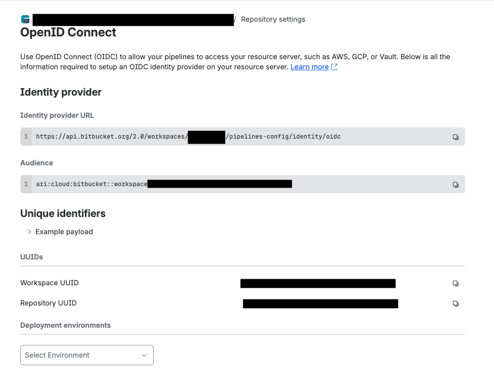
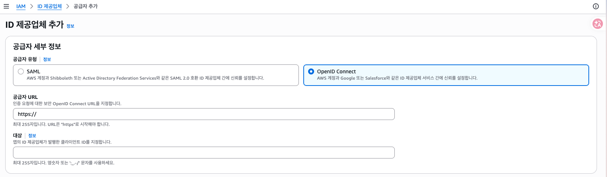
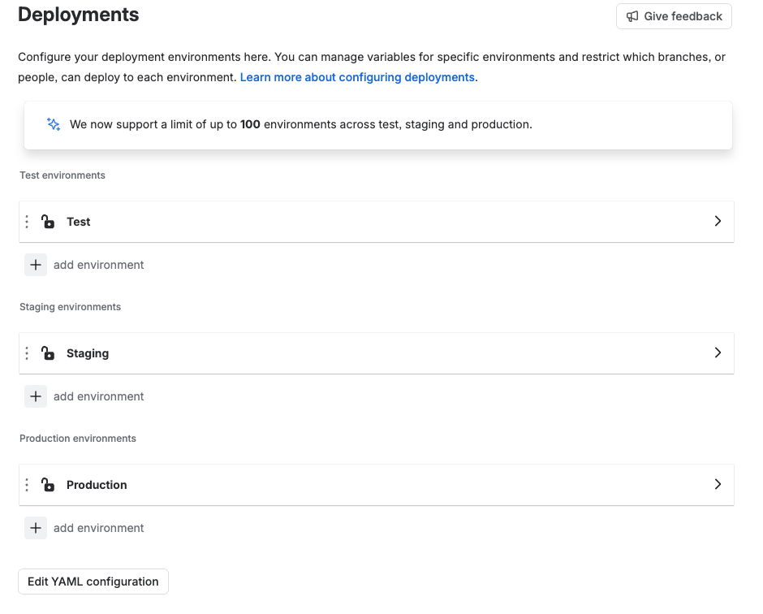
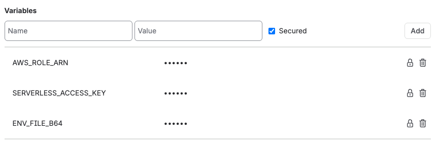
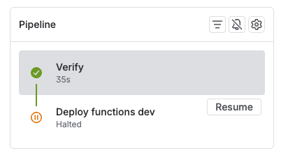
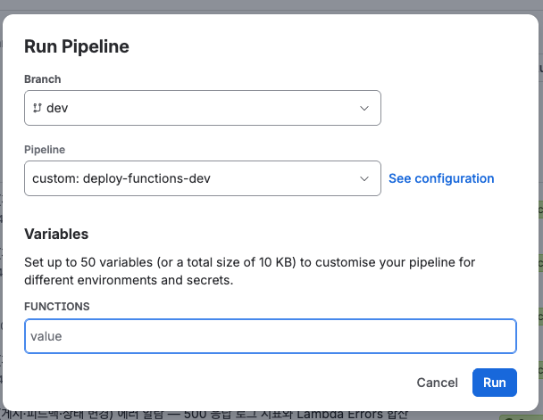

Lambda 40여 개가 들어있는 Serverless Framework 프로젝트를 지금까지는 로컬에서 `sls deploy`로 배포하고 있었다. 
혼자 관리하는 저장소라 큰 문제는 없었는데, 어느 순간부터 "지금 상용에 올라가 있는 코드가 어느 커밋이지?"를 대답하지 못하는 상황이 가끔 생겼다. 🙃 
로컬 브랜치에서 급하게 배포하고 머지는 나중에 하다 보니 배포된 코드와 저장소 코드가 어긋나는 상황이 간혹 발생한 것이다. 실수를 줄이기 위해 Bitbucket Pipelines로 배포를 옮기기로 했다.

처음 목표는 단순했다.

- 앞으로 배포는 파이프라인에서만 한다.
- AWS Access Key를 Bitbucket에 저장하지 않는다.
- 어떤 커밋이 배포됐는지 AWS 쪽에 기록이 남도록 한다.

추가적으로 머지할 때마다 serverless 스택 전체가 배포되는 게 부담스럽다는 문제가 추가로 생겨서 구조를 중간에 한 번 바꿨는데, 그 과정까지 정리해둔다.

## 전체 구조

최종적으로 만든 흐름은 이렇다.

```
PR 생성           → Verify (테스트만)
dev 머지          → Verify → [Deploy dev (전체)] 버튼 대기
master 머지       → Verify → [Deploy prod (전체)] 버튼 대기
Run pipeline 수동 → deploy-functions-<stage> (함수 단위 배포, 가드 통과 시)
```

브랜치 머지를 해도 배포가 바로 발생하지 않는다. 배포는 Bitbucket 버튼을 내가 수동으로 눌렀을 때만 실행되도록 했다.
처음에는 dev 머지 = 자동 배포로 만들었는데 이걸 바꾼 이유는 아래에서 다시 설명한다.

### 왜 Serverless Dashboard CI/CD를 안 썼나

Serverless v4 대시보드에도 저장소를 연결해 브랜치별로 자동 배포해주는 CI/CD 기능이 있고 Bitbucket도 지원한다. 설정만 보면 훨씬 간단하다. 다만 이 기능을 쓰려면 대시보드에 AWS Provider를 연결해야 하는데, 이건 Serverless 회사 계정이 우리 AWS 계정에 관리자 권한으로 들어올 수 있는 역할을 만드는 것이다. 또한 push하면 전체 서비스 단위가 바로 배포되는 방식이라 아래에서 얘기할 수동 배포, 함수 단위 배포가 불가능하다. 그런 이유들로 Bitbucket Pipelines로 직접 구성하기로 했다.

## AWS 인증: Access Key 대신 OIDC

Bitbucket 파이프라인에서 AWS에 배포하려면 자격 증명이 필요하다. 제일 쉬운 방법은 IAM 사용자의 Access Key를 Bitbucket 변수에 넣는 건데, 이러면 만료되지 않는 키가 외부 서비스에 저장되고, 이 키가 노출되면 공격자는 그 키로 무엇이든 할 수 있다.

Bitbucket Pipelines는 OIDC를 지원한다. step에 `oidc: true`를 주면 Bitbucket이 그 step 전용 토큰을 발급해주고, AWS는 이 토큰을 보고 "이건 Bitbucket이 발급한, 이 저장소의 이 환경에서 온 요청이다"를 확인한 뒤 임시 자격 증명을 내준다. 저장해둘 키가 아예 없다.

> OIDC
> OIDC(OpenID Connect)는 "이 요청을 누가 보냈는지"를 **서명된 토큰(JWT)** 으로 증명하는 표준 인증 스펙이다. 
> 받는 쪽은 대칭키를 공유받지 않고, 발급자가 비대칭키 시크릿키로 암호화된 토큰을 발급자의 **공개키로 서명만 검증**하는 것으로 인증을 할 수 있다.
> 사용되는 값은  1. `iss` 발급자, 2. `aud` 이 토큰을 받을 대상, 3. `sub` 토큰의 주인, 4. `exp`: 만료 시각 이렇게 네 가지가 있다.

```
Bitbucket step (oidc: true)
   │  BITBUCKET_STEP_OIDC_TOKEN 발급
   ▼
AWS STS AssumeRoleWithWebIdentity
   │  신뢰 정책에서 aud(토큰 발급 대상), sub(토큰의 주인) 확인
   ▼
임시 자격 증명 (1시간)
   ▼
serverless deploy
```

### 1. OIDC 공급자 등록

Bitbucket의 Repository settings → Pipelines → OpenID Connect 화면에 Identity provider URL과 Audience가 나온다. 이걸로 AWS 계정에 공급자를 만든다.



#### cli
```bash
aws iam create-open-id-connect-provider \
  --url https://api.bitbucket.org/2.0/workspaces/<workspace>/pipelines-config/identity/oidc \
  --client-id-list ari:cloud:bitbucket::workspace/<workspace-uuid>
```

#### console



`IAM > ID 제공업체 > 공급자 추가`에서 추가할 수 있다. 공급자 URL은 `https://api.bitbucket.org/2.0/workspaces/<workspace>/pipelines-config/identity/oidc`, Audience는 `ari:cloud:bitbucket::workspace/<workspace-uuid>`이다.

### 2. 역할과 신뢰 정책 생성

다음은 AWS 역할 생성이다. 핵심은 신뢰 정책의 `Condition`이다.

```json
{
  "Version": "2012-10-17",
  "Statement": [{
    "Effect": "Allow",
    "Principal": { "Federated": "arn:aws:iam::<account>:oidc-provider/api.bitbucket.org/2.0/workspaces/<workspace>/pipelines-config/identity/oidc" },
    "Action": "sts:AssumeRoleWithWebIdentity",
    "Condition": {
      "StringEquals": { "api.bitbucket.org/2.0/workspaces/<workspace>/pipelines-config/identity/oidc:aud": "ari:cloud:bitbucket::workspace/<workspace-uuid>" },
      "StringLike":   { "api.bitbucket.org/2.0/workspaces/<workspace>/pipelines-config/identity/oidc:sub": "{<repo-uuid>}:{<env-uuid>}:*" }
    }
  }]
}
```

- `aud`: 우리 workspace에서 발급된 토큰인지
- `sub`: 어느 저장소의 어느 배포 환경에서 실행된 step인지

`sub` 값의 모양은 `{저장소 UUID}:{배포 환경 UUID}:{step UUID}` 형태다. step UUID는 실행할 때마다 바뀌기 때문에 마지막 값은 `*`로 열어둔다. UUID 값은 중괄호를 포함해서 설정하면 된다.

dev 계정과 prod 계정이 따로 있어서 AWS 공급자와 역할도 계정마다 각각 만들고, 각 역할의 sub 조건에는 그 계정에 맞는 배포 환경 UUID만 넣었다.

### 3. 배포 환경(Deployment environment)

처음에 "환경"이라는 말이 헷갈렸는데, Bitbucket의 배포 환경은 브랜치도 서버도 아니고 배포 대상에 붙이는 이름표 같은 거다. Repository settings → Pipelines → Deployments에 Test / Staging / Production 칸이 있고 그 안에 환경을 만드는 방식이다. 



yml에서 step에 `deployment: dev`라고 쓰면 그 이름의 환경에 연결된다.

프로젝트의 환경 이름을 `dev`, `prod`로 바꾸고 그 이름을 그대로 serverless stage로 쓰게 했다. step 안에서 `BITBUCKET_DEPLOYMENT_ENVIRONMENT`로 이름을 읽을 수 있다.

그 외에 Bitbucket 환경 변수로 추가해야 할 변수들이 있었다.

- AWS_ROLE_ARN : 위 2번에서 생성한 역할 arn
- SERVERLESS_ACCESS_KEY : serverelss 배포를 위한 api key. serverless v4 api key는 대시보드에서 생성할 수 있었다.
- ENV_FILE_B64 : .env 파일의 base64 인코딩 텍스트

모든 변수는 secured로 등록했다.



## env 파일은 어떻게 넘기나

로컬에서는 `.env.dev`, `.env.prod` 파일로 환경변수를 관리하고 있었다. 키가 30개 가까이 돼서 Bitbucket 변수로 하나씩 옮기는 건 관리가 안 될 것 같았다. 그래서 파일을 통째로 base64 인코딩하여 `ENV_FILE_B64`라는 Secured 변수를 생성해 거기에 값을 넣고, 배포 step에서 다시 파일로 복원하도록 했다.

이 부분은 추후에 serverless v4의 환경변수 설정하는 기능으로 대체하는 것도 고려중이다.

```bash
base64 -i .env.dev | tr -d '\n' | pbcopy   # 로컬에서 클립보드로 복사. 이 값을 환경 변수 값으로 넣으면된다.
```

```bash
printf '%s' "$ENV_FILE_B64" | base64 -d > ".env.${STAGE}"   # 추후 파이프라인에서 복원하는 코드
```

대신 파일을 인코딩한 문자열을 넣으면 키를 빠뜨리거나 prod 파일에 dev 큐 URL을 넣는 등의 실수를 잡기가 어렵다. 그래서 배포 전에 env 파일을 검사하는 스크립트(`check-env.js`)를 안전장치로 두었다.

- 필수 키 목록은 따로 관리하지 않고 `serverless.yml`의 `${env:KEY}` 참조에서 필요한 값의 리스트를 추출한다. 기본값이 없는 `${env:KEY}`는 필수, `${env:KEY, 'default'}`는 옵셔널한 변수로 처리했다.
- ARN, SQS URL 안의 AWS 계정 ID가 stage의 계정과 같은지 본다. prod 파일에 dev 계정 리소스가 들어있으면 배포가 더이상 진행되지 않고 여기서 멈춘다.
- 값은 절대 출력하지 않고 키 이름과 사유만 출력하도록 했다.

```
# 출력 예시
✓ dev (.env.dev): 29 required / 21 optional (9 using defaults)
· DEPLOYED_BY: not set, serverless.yml default used
...
```

## bitbucket-pipelines.yml 파일 작성

전체 파일은 아래와 같이 작성했다.

```yml
# 병합은 배포하지 않는다. dev·master 병합 → Verify 후 전체 배포 버튼 대기, PR → 검증만.
# 함수 코드만 바뀌었으면 Run pipeline → deploy-functions-<stage> 로 함수 단위 배포.
image: node:24

definitions:
  steps:
    # 비밀값 없이 lock 정합성과 스크립트 테스트만 본다. 캐시 사용 가능.
    - step: &verify
        name: Verify
        caches:
          - node
        script:
          - export COREPACK_ENABLE_DOWNLOAD_PROMPT=0
          - corepack enable
          - yarn install --frozen-lockfile
          - yarn test:scripts
    # 배포 step 은 캐시를 쓰지 않는다. 공유 node 캐시가 prod 번들에 섞이지 않게 하기 위해서다.
    - step: &deploy-stack
        name: Deploy
        oidc: true
        trigger: manual
        script:
          - bash scripts/ci/deploy.sh stack
    # 가드가 마지막 전체 배포 커밋과 비교하므로 전체 이력을 받는다.
    - step: &deploy-functions
        name: Deploy functions
        oidc: true
        clone:
          depth: full
        script:
          - bash scripts/ci/deploy.sh functions

pipelines:
  pull-requests:
    "**":
      - step: *verify
  branches:
    dev:
      - step: *verify
      - step:
          <<: *deploy-stack
          name: Deploy dev (전체)
          deployment: dev
    master:
      - step: *verify
      - step:
          <<: *deploy-stack
          name: Deploy prod (전체) — 가장 최근 커밋인지 확인 후 승인
          deployment: prod
  custom:
    deploy-functions-dev:
      # FUNCTIONS: serverless.yml functions 키. 여러 개는 공백·쉼표로 구분
      # (변수 description 키는 공식 문서에 없어 주석으로 둔다)
      - variables:
          - name: FUNCTIONS
      - step: *verify
      - step:
          <<: *deploy-functions
          name: Deploy functions dev
          deployment: dev
    deploy-functions-prod:
      # FUNCTIONS: serverless.yml functions 키. 여러 개는 공백·쉼표로 구분
      # (변수 description 키는 공식 문서에 없어 주석으로 둔다)
      - variables:
          - name: FUNCTIONS
      - step: *verify
      - step:
          <<: *deploy-functions
          name: Deploy functions prod — 확인 후 승인
          deployment: prod
          trigger: manual

```

dev와 prod 환경에서 같은 순서의 파이프라인을 공유하기 때문에 yaml의 anchor를 사용해 중복되는 부분을 줄였다.

## 배포 스크립트 순서

yml에는 `bash scripts/ci/deploy.sh stack` 한 줄만 두고 실제 순서는 스크립트에 넣었다. 실행 순서를 테스트 실행에서 검사할 수 있게 하기 위해서였다

```bash
set -euo pipefail

STAGE="${BITBUCKET_DEPLOYMENT_ENVIRONMENT:?deployment environment 가 없는 step 에서 실행됨}"
: "${ENV_FILE_B64:?Deployment 변수 ENV_FILE_B64 가 비어 있음}"
: "${AWS_ROLE_ARN:?Deployment 변수 AWS_ROLE_ARN 이 비어 있음}"
: "${SERVERLESS_ACCESS_KEY:?Deployment 변수 SERVERLESS_ACCESS_KEY 가 비어 있음}"
: "${BITBUCKET_STEP_OIDC_TOKEN:?OIDC 토큰이 없음 — step 에 oidc: true 필요}"

# `:?` 문법은 변수가 비어 있으면 메시지를 찍고 바로 종료한다. 변수 등록을 빠뜨려 serverless가 이상한 에러를 내기 전에 배포를 막기 위해 추가했다.

node scripts/ci/check-branch.js --stage "$STAGE"     # 1. 브랜치 확인

corepack enable
yarn install --frozen-lockfile                       # 2. 의존성 설치
npm install -g serverless@4.45.0

printf '%s' "$ENV_FILE_B64" | base64 -d > ".env.${STAGE}"
node scripts/check-env.js --stage "$STAGE" --role-arn-from-env   # 3. env 복원 + 검사
DEPLOYED_ENV_HASH="$(sha256sum ".env.${STAGE}" | cut -d' ' -f1)"

TOKEN_FILE="$(mktemp)"                               # 4. OIDC 자격 증명
printf '%s' "$BITBUCKET_STEP_OIDC_TOKEN" > "$TOKEN_FILE"
export AWS_WEB_IDENTITY_TOKEN_FILE="$TOKEN_FILE" AWS_ROLE_ARN AWS_REGION=ap-northeast-2 \
       DEPLOYED_BY=pipeline DEPLOYED_ENV_HASH

serverless deploy --stage "$STAGE"                   # 5. 배포
```

`AWS_WEB_IDENTITY_TOKEN_FILE`과 `AWS_ROLE_ARN`만 export하면 AWS SDK가 알아서 AssumeRoleWithWebIdentity를 호출한다. serverless 쪽에서 따로 설정할 건 없다.

신경 쓴 부분은 의존성 설치를 env 복원과 자격 증명보다 먼저 한다는 점이다. `yarn install`은 패키지의 postinstall 스크립트를 실행한다. 이 시점에 디스크에 `.env`가 있고 환경변수에 AWS 자격 증명이 있으면, 악성 패키지 하나가 둘 다 가져갈 수 있다. 설치를 먼저 끝내두면 적어도 그 경로는 막힌다.


## 어떤 커밋이 배포됐는지 남기기

처음 문제였던 지금 배포된 게 어느 커밋인지 추적하는 문제는 CloudFormation 스택 Outputs로 해결했다.

```yaml
# serverless.yml
resources:
  Outputs:
    DeployedCommit:
      Value: ${env:BITBUCKET_COMMIT, 'local'}
    DeployedBy:
      Value: ${env:DEPLOYED_BY, 'local'}
    DeployedBuild:
      Value: ${env:BITBUCKET_BUILD_NUMBER, 'local'}
    DeployedEnvHash:
      Value: ${env:DEPLOYED_ENV_HASH, 'local'}
```

파이프라인에서 배포하면 DEPLOYED_BY 값으로 `pipeline`이 들어가고, 로컬에서 배포하면 `local`이 들어간다. 배포 스택 값의 확인은 다음 명령어로 가능하다.

```bash
aws cloudformation describe-stacks --stack-name <service>-dev \
  --query "Stacks[0].Outputs[?starts_with(OutputKey,'Deployed')]" --output table
```

`DeployedEnvHash`는 env 파일의 sha256이다. 처음엔 없었는데 아래에 나오는 함수 단위 배포 때문에 추가했다.

## 머지할 때마다 전체 배포?.. 이건 안된다

처음 버전은 dev에 머지하면 자동으로 `serverless deploy`가 돌았다. 그런데 여기까지 구축을 하고 나니 함수 하나만 고쳐도 serverless 스택 전체가 다 배포되는 게 맞나..?

`serverless deploy`는 함수를 골라서 올리는 명령이 아니라 CloudFormation 스택 하나를 통째로 갱신하는 명령이다. 로컬에서 작업할 때는 보통 `serverless deploy function -f`를 사용했는데 파이프라인 자동화를 사용하면 그렇게 할 수가 없게된다. 개별 함수 `package.individually: true`로 함수별 zip을 따로 만들어도 소용없다. Serverless 4.45.0 코드를 열어보니 아티팩트를 S3에 올리는 경로에 배포 시각이 들어간다.

```js
artifactDirectoryName = `${prefix}/${serviceStage}/${dateString}`
```

매 배포마다 새 경로에 zip이 올라가니까 모든 함수의 `Code.S3Key`가 바뀌고, CloudFormation 입장에서는 함수 40여 개 전부가 업데이트 대상이 된다. 템플릿과 zip이 직전 배포와 완전히 같을 때만 배포 자체를 건너뛰게 되고 실제로 첫 dev 파이프라인 배포 후 확인해보니 함수 44개의 `LastModified`가 전부 방금 전으로 갱신되어있었다.

머지할 때마다 관계없는 함수까지 교체되는 건 부담이 컸다. 그렇다고 아예 자동 배포를 빼면 다시 로컬 배포로 돌아갈 것 같았다. 그래서 결론적으로는 다음과 같이 배포 옵션을 나눴다.

- 머지는 검증만 한다. 전체 배포는 Verify 뒤에 수동 버튼(`trigger: manual`)으로 둔다.
- 함수 코드만 바뀐 경우는 `serverless deploy function`으로 함수 단위 배포를 할 수 있게 custom 파이프라인을 따로 만든다.

```yaml
pipelines:
  branches:
    dev:
      - step: *verify
      - step:
          <<: *deploy-stack          # trigger: manual
          name: Deploy dev (전체)
          deployment: dev
  custom:
    deploy-functions-dev:
      - variables:
          - name: FUNCTIONS          # 실행할 때 함수 이름 입력
      - step: *verify
      - step:
          <<: *deploy-functions
          name: Deploy functions dev
          deployment: dev
```



이런 식으로 bitbucket 파이프라인 페이지에 단계가 끝나면 버튼이 생긴다. 테스트(Verify)가 끝나면 배포 버튼이 생기고, 눌러야 배포 step이 실행된다



또한 커스텀 파이프라인을 생성했다. Run pipeline 버튼을 누르면 실행할 수 있는데 variable로 FUNCTIONS을 두고 이곳에 입력한 함수만 개별 업데이트가 가능하도록 했다.

## deploy function은 우회로다

`serverless deploy function -f X`는 빠르지만 CloudFormation을 거치지 않고 Lambda API로 함수를 직접 바꾼다. 처음엔 코드만 바꾸는 줄 알았는데 Serverless 코드를 확인해보니 함수 설정(env, timeout, memory 등)까지 같이 바꾸고 있었다.

| | `serverless deploy` | `serverless deploy function -f X` |
|---|---|---|
| 경로 | CloudFormation 스택 업데이트 | Lambda API 직접 호출 |
| 범위 | 함수 전부 + IAM + 리소스 | 함수 X의 코드와 설정 |
| IAM 권한, 이벤트, 새 함수 | 반영됨 | 반영 안 됨 |
| 실패하면 | CloudFormation이 롤백 | 롤백 없음 |

예를 들어 `serverless.yml`에 IAM 권한을 추가하고 함수 배포만 하면, 코드는 새 권한을 쓰려고 하는데 권한은 없는 상태가 된다. 그래서 함수 배포는 "마지막 전체 배포 이후 코드만 바뀌었을 때"만 허가되도록 앞단에 검사 스크립트 가드를 붙였다.

## 함수 배포 가드

가드는 스택 Outputs에 남겨둔 마지막 전체 배포 기록(커밋, env 해시)을 기준으로 아래를 확인하고, 하나라도 걸리면 배포를 멈춘다.

1. 정해진 브랜치에서 실행했는가 (dev 환경은 `dev`, prod 환경은 `master`)
2. 지금 커밋이 그 브랜치의 최신 커밋인가
3. 파이프라인으로 전체 배포한 기록이 있는가
4. env 파일이 마지막 전체 배포 때와 같은가
5. 마지막 전체 배포 커밋 이후의 코드인가 (아니면 코드가 과거로 돌아간다)
6. 마지막 전체 배포 이후 `serverless.yml`이 바뀌지 않았는가

git 확인이 실패하면(이력을 못 받았거나 원격에 접근이 안 되면) 통과가 아니라 거부로 처리했다.

2번과 5번은 파이프라인 적용 후 테스트를 진행하다가 나중에 추가한 조건이다. Bitbucket은 대기 중인 수동 버튼을 한참 뒤에 눌러도 그 파이프라인이 만들어졌던 옛날 커밋으로 실행된다. 그래서 그 사이 다른 배포가 있었다면 옛날 코드로 덮어버릴 수 있어서, 실행 시점에 원격 브랜치를 다시 받아 최신 커밋과 비교한다. 수동 배포 버튼을 쓴다면 생각해볼 만한 부분이다.

## Premium이 아니라서 생기는 구멍

Bitbucket Premium이면 "prod 환경은 master에서만 배포 가능"처럼 배포 환경을 브랜치로 제한할 수 있는데, 나는 Premium을 사용하고 있지 않다. OIDC 토큰의 sub에도 브랜치 정보가 없어서 AWS 신뢰 정책으로도 막을 수 없었다. 그래서 배포 스크립트 첫 단계에서 브랜치를 확인하도록 했지만 이건 실수 방지일 뿐 시스템 단위로 막는 보안 장치는 아니다. 아쉬운 부분이다.

## 첫 배포

배포 스크립트 순서, 가드 조건, yml의 `trigger: manual` 같은 건 `node --test`로 테스트를 만들어 Verify 단계에서 같이 돌게 했다. yml anchor를 쓰다 보면 `trigger: manual` 하나 빠져서 머지하자마자 배포되는 실수가 충분히 생길 수 있다.

dev에 머지하고 Verify가 통과한 뒤 버튼을 눌렀다. 스택 업데이트가 끝나고 Outputs를 확인해보면,

```
DeployedCommit   <commit-sha>     ← dev 최신 커밋
DeployedBy       pipeline
DeployedEnvHash  <sha256>         ← 로컬 .env.dev sha256 과 같음
DeployedBuild    1
```

이제 dev에 무엇이 배포됐는지 AWS에서 바로 확인할 수 있다. 다음은 함수 단위 배포를 실제로 돌려보고 prod 계정에도 같은 구성을 하는 것이다.

## 정리

- 배포 자격 증명은 OIDC로. 신뢰 정책의 sub에 저장소와 배포 환경 UUID를 넣어 계정별로 묶는다.
- `serverless deploy`는 항상 스택 전체를 갱신한다. 머지할 때마다 돌리기 부담스러우면 수동 버튼으로.
- `serverless deploy function`은 CloudFormation 우회로라서, 쓰려면 "코드 말고는 안 바뀌었다"를 확인하는 장치가 필요하다.
- Premium이 아니면 배포 환경을 브랜치로 제한할 수 없다. 스크립트로 막는 건 실수 방지일 뿐이다.

## 참고

- https://support.atlassian.com/bitbucket-cloud/docs/integrate-pipelines-with-resource-servers-using-oidc/
- https://support.atlassian.com/bitbucket-cloud/docs/set-up-and-monitor-deployments/
- https://www.serverless.com/framework/docs/providers/aws/guide/deploying
- https://www.serverless.com/framework/docs/providers/aws/cli-reference/deploy-function
- https://www.serverless.com/pricing
