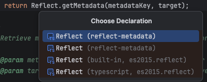

# NestJS 데코레이터

데코레이터를 매일 쓰고 있지만 내부 동작을 알지 못한 채 사용하니 그저 마법같이 느껴졌다. 그 통제 불능의 상태가 답답해서 한번 깊게 정리를 해보고자 글을 작성한다.

결론부터 말하면 NestJS 데코레이터는 마법이 아니라 메모다. 데코레이터는 클래스가 정의될 때 실행되어 "이 클래스(메서드)에는 이런 정보가 있다"는 메타데이터를 적어 두는 함수다. Nest는 앱을 시작할 때나 요청을 처리할 때 그 메모를 읽어서 동작한다. 이 글에서는 커스텀 데코레이터 하나를 골라 메모가 적히는 곳까지 코드를 따라 내려갔다가, 메모를 읽는 쪽으로 다시 올라온다.

데코레이터 문법 자체는 [Typescript decorator 알아보기](/blog/javascript/typescript-decorator/)에 정리해 두었다.

## 메타데이터를 저장하고 읽는 API

NestJS의 데코레이터는 `@nestjs/common` 패키지에서 제공된다. 다만 메타데이터를 저장하고 읽는 API는 NestJS가 아니라 `reflect-metadata` 패키지에 정의되어 있다.

```js
import 'reflect-metadata';

class Cat {}

Reflect.defineMetadata('role', 'admin', Cat);   // 메타데이터 저장
Reflect.getMetadata('role', Cat);               // 'admin' 읽기
```

`Reflect`는 ES6부터 들어간 내장 객체지만 `defineMetadata`와 `getMetadata`는 내장 함수가 아니다. global `Reflect` 객체에 `reflect-metadata`가 추가한 API이다.

같은 원리로 `@Controller('cat')`을 등록한 클래스는 `Controller` 데코레이터에 의해 `path: cat`이라는 메타데이터가 붙는다. Nest는 앱을 시작할 때 앱에 등록된 클래스들의 메타데이터들을 읽고 이를 기반으로 라우트를 등록한다. `@Get()`, `@Injectable()` 등도 마찬가지이다.

## 커스텀 데코레이터

NestJS에서 제공하는 기본 데코레이터 외에도 직접 데코레이터를 만들어서 사용할 수 있다. 핸들러에 메타데이터를 붙이는 데코레이터는 `@nestjs/core` 패키지의 `Reflector.createDecorator()` 함수로 만든다.

```ts
import { Controller, Post } from '@nestjs/common';
import { Reflector } from '@nestjs/core';

export const Roles = Reflector.createDecorator<string[]>();

@Controller('cats')
export class CatsController {
  @Post()
  @Roles(['admin'])
  create() {}
}
```

요청에서 값을 꺼내 핸들러 인자로 넣어 주는 `createParamDecorator()`도 있다. 저장하는 키와 대상이 다를 뿐, `Reflect.defineMetadata`로 메타데이터를 남긴다는 점은 같다. 이 글에서는 `Roles`를 따라간다.

## NestJS 데코레이터를 찾아서

그렇다면 `@Roles(['admin'])`을 붙였을 때 어떤 일이 일어나는 걸까? 먼저 `createDecorator` 함수 구현부를 따라가봤다.

```js
// @nestjs/core - reflector.service.js
export class Reflector {
  static createDecorator(options = {}) {
    const metadataKey = options.key ?? uid(21);
    const decoratorFn = (metadataValue) => (target, key, descriptor) => {
      const value = options.transform
        ? options.transform(metadataValue)
        : metadataValue;
      SetMetadata(metadataKey, value === undefined ? {} : value)(target, key, descriptor);
    };
    decoratorFn.KEY = metadataKey;
    return decoratorFn;
  }
}
```

`createDecorator`가 직접 하는 일은 메타데이터 키를 정하는 것뿐이다. 키를 넘기지 않으면 `uid(21)`로 무작위 키를 만든다. 실제 저장은 내부에서 `SetMetadata`를 쓰고 있었다. 이 함수를 다시 따라가보자.

```js
// @nestjs/common - set-metadata.decorator.js
export const SetMetadata = (metadataKey, metadataValue) => {
  const decoratorFactory = (target, key, descriptor) => {
    if (descriptor) { // 메서드의 경우
      Reflect.defineMetadata(metadataKey, metadataValue, descriptor.value);
      return descriptor;
    }
    Reflect.defineMetadata(metadataKey, metadataValue, target); // 클래스의 경우
    return target;
  };
  decoratorFactory.KEY = metadataKey;
  return decoratorFactory;
};
```

여기서 봐야 할 것은 `descriptor`가 있을 때의 분기다. 메서드에 붙인 데코레이터는 세 번째 인자로 `descriptor`를 받고, 클래스에 붙인 데코레이터에는 세 번째 인자가 없다.

> `descriptor`는 JS가 객체의 프로퍼티마다 들고 있는 설정 정보다. 메서드도 프로토타입의 프로퍼티이기 때문에 `descriptor`가 존재하고, 그 `value`에 메서드 함수 자체가 들어 있다.

메서드에 붙인 경우 메타데이터의 대상은 클래스가 아니라 `descriptor.value`, 즉 메서드 함수 자체다. 이때 `target`은 프로토타입이다. `target`에 저장했다면 대상이 프로토타입 하나뿐이라 어느 메서드의 메타데이터인지 구분할 수 없다. 클래스에 붙인 경우에는 클래스(`target`)가 그대로 대상이 된다. 이 차이는 뒤에서 메타데이터를 읽을 때 다시 나온다.

드디어 나타난 `Reflect` 객체. 이제 이 객체의 코드를 보자.



`Reflect` 코드에 따라가기를 하면 이렇게 두 가지가 나온다. ES 기본 라이브러리와 `reflect-metadata` 라이브러리 두 종류이다. `defineMetadata`는 기본 라이브러리에 `reflect-metadata`가 추가한 API이다. `defineMetadata` 구현부를 더 자세히 보자.

```ts
// reflect-metadata - index.d.ts
function defineMetadata(metadataKey: any, metadataValue: any, target: Object): void;
```

정의 파일은 이렇게 나와있고 아래가 구현부다.

```js
// reflect-metadata - Reflect.js
function defineMetadata(metadataKey, metadataValue, target, propertyKey) {
  if (!IsObject(target))
    throw new TypeError();
  if (!IsUndefined(propertyKey))
    propertyKey = ToPropertyKey(propertyKey);
  return OrdinaryDefineOwnMetadata(metadataKey, metadataValue, target, propertyKey);
}

// 바깥 함수: 어느 provider(저장소)가 담당인지 고르고 넘긴다
function OrdinaryDefineOwnMetadata(MetadataKey, MetadataValue, O, P) {
  var provider = GetMetadataProvider(O, P, /*Create*/ true);
  provider.OrdinaryDefineOwnMetadata(MetadataKey, MetadataValue, O, P);
}

// provider 안쪽 함수: 실제로 저장한다
function OrdinaryDefineOwnMetadata(MetadataKey, MetadataValue, O, P) {
  var metadataMap = GetOrCreateMetadataMap(O, P, /*Create*/ true);
  metadataMap.set(MetadataKey, MetadataValue);
}
```

`OrdinaryDefineOwnMetadata`가 자기 자신을 부르는 것처럼 보이지만 재귀가 아니다. 이름이 같은 함수가 서로 다른 스코프에 하나씩 있다. 바깥 함수는 담당 provider를 고르기만 하고, provider 안쪽 함수가 실제로 저장한다. `reflect-metadata`가 여러 벌 설치되어도 서로의 메타데이터를 읽을 수 있게 하려고 한 단계를 더 둔 것이다.

안쪽 함수를 보면 메타데이터 Map에 key를 사용해 value를 저장하고 있다. `GetOrCreateMetadataMap`이 돌려주는 Map은 아래 구조에서 가장 안쪽에 있는 Map이다.

```
WeakMap
  └─ 대상 객체 (클래스, 메서드 함수)
       └─ Map
            └─ 프로퍼티 키 (없으면 undefined)
                 └─ Map
                      └─ 메타데이터 키  →  값
```

여기가 메타데이터 로직의 바닥이다. 바닥까지 내려와서 알게 된 것은 두 가지다.

- 메타데이터는 클래스나 메서드에 직접 붙지 않는다. 전역 `Reflect` 객체에 들어가는 것도 아니다. `Reflect`에는 함수만 붙어 있고, 값은 `reflect-metadata` 모듈 안의 `WeakMap`에 저장된다.
- `defineMetadata`가 맨 처음 `IsObject(target)`을 검사한 이유도 여기에 있다. 문자열이나 숫자는 `WeakMap`의 키가 될 수 없다.

## 저장한 메타데이터는 누가 읽을까

적어 둔 메모는 읽는 쪽이 있어야 동작이 된다. `Roles`는 보통 Guard에서 읽는다.

```ts
@Injectable()
export class RolesGuard implements CanActivate {
  constructor(private reflector: Reflector) {}

  canActivate(context: ExecutionContext): boolean {
    const roles = this.reflector.get(Roles, context.getHandler());
    if (!roles) {
      return true;
    }
    const request = context.switchToHttp().getRequest();
    return roles.includes(request.user?.role);
  }
}
```

`context.getHandler()`는 지금 요청을 처리할 메서드 함수를 돌려준다. `SetMetadata`가 대상으로 삼았던 `descriptor.value`와 같은 함수다. 그래서 메서드에 붙인 메타데이터는 `getHandler()`로, 클래스에 붙인 메타데이터는 `getClass()`로 읽어야 한다.

`reflector.get`의 구현은 짧다.

```js
// @nestjs/core - reflector.service.js
get(metadataKeyOrDecorator, target) {
  const metadataKey = metadataKeyOrDecorator.KEY ?? metadataKeyOrDecorator;
  return Reflect.getMetadata(metadataKey, target);
}
```

`createDecorator`가 `decoratorFn.KEY`에 키를 달아 둔 이유가 여기서 드러난다. 무작위로 만든 키를 몰라도 데코레이터 자체를 넘기면 같은 키로 읽을 수 있다.

쓰는 시점과 읽는 시점도 다르다. 데코레이터는 클래스가 정의될 때 한 번 실행되어 메타데이터를 저장하고, Guard는 요청이 올 때마다 그 메타데이터를 읽는다.

## 데코레이터와 DI

NestJS의 DI(Dependency Injection)도 같은 저장소를 쓴다. NestJS는 `@Injectable()` 데코레이터를 사용해 클래스를 DI 대상으로 등록하고, `@Inject()` 데코레이터를 사용해 의존성을 주입할 수 있다.

```ts
@Injectable()
class CatsService {
  constructor(private catsRepository: CatsRepository) {}
}

// Nest 내부에서 대략 이렇게 읽음
Reflect.getMetadata('design:paramtypes', CatsService); // [CatsRepository]
```

`design:paramtypes`는 NestJS가 아니라 TypeScript 컴파일러가 남기는 메타데이터다. 자세한 내용은 [Typescript decorator 알아보기](/blog/javascript/typescript-decorator/)의 `emitDecoratorMetadata` 절에 정리해 두었다.

## 정리

- NestJS 데코레이터는 클래스가 정의될 때 실행되어 메타데이터를 저장하는 함수다.
- 저장 경로는 `createDecorator` → `SetMetadata` → `Reflect.defineMetadata` → `reflect-metadata` 내부의 `WeakMap`이다.
- 전역 `Reflect` 객체는 함수가 붙어 있는 자리일 뿐이고, 값은 `reflect-metadata` 모듈이 들고 있다.
- Nest는 앱을 시작할 때나 요청을 처리할 때 `Reflect.getMetadata`로 그 값을 읽어서 라우팅, 권한 검사, DI를 수행한다.

마법처럼 보였던 것은 결국 "적어 두고, 나중에 읽는다"였다.

## 참고
- [Nest 공식 문서 - Custom route Decorators](https://docs.nestjs.com/custom-decorators)
- [Nest 공식 문서 - Reflection and metadata](https://docs.nestjs.com/fundamentals/execution-context#reflection-and-metadata)
- [reflect-metadata](https://github.com/rbuckton/reflect-metadata)
