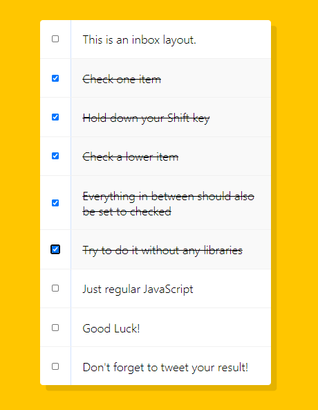

# Javascript30 Day10<br> 　- Hold Shif and Check Checkboxes

## 프로그램 기능


구현해야 하는 기능은 하나의 체크 박스를 선택하고 `Shift` 키를 누른 상태로 위/아래의 다른 체크 박스를 선택하면 그 사이에 있는 모든 체크 박스가 함께 선택되는 기능이다.
이런 기능은 다양한 프로그램에서 사용되는 기능이다. 예를 들어 Gmail에서 여러개의 메일을 선택할 때 등등.

## 스스로 풀이 도전

스스로 해볼 수 있을 것 같아서 강의를 듣기 전에 내가 구현해보려고 했다. 그동안 배웠던 `keydown`을 사용해서 해봤다.

1. input elements 들을 `querySelectorAll`로 선택해둔다.
2. `forEach`를 사용해 각 `checkbox`들에 `click` 이벤트를 등록한다.
3. flag 변수를 선언해놓고 `click` 이벤트 내부에서 `keydown`이벤트를 또 걸어놓는다.
4. flag 변수가 `False` 일 경우 이번에 선택 된 엘리먼드의 index를 `lastChecked`에 저장해놓는다.
5. Shift 키를 누른 상태로 두번째 체크박스를 클릭하면 이벤트가 발생된다.
6. lastChecked 부터 이번에 선택된 index 까지 checkbox들의 `checked`를 `true`로 설정한다.

잘 되는 듯 보였는데 `Flag` 변수의 설정이 곧바로 되지 않아서 이 상태로 두고 강의를 들었다.

한가지 배운 점은 `NodeList`에서 `Array.prototype.indexOf()` 메서드를 사용하기 위해서 어떻게 해야 될까 찾아보다가 메서드를 그대로 등록하면 된다는 것을 배웠다.
두 자료구조는 매우 비슷해서 다른 형으로 변환하는 방법도 있지만 아래와 같이 써도 깔끔한 것 같다.

```js
NodeList.prototype.indexOf = Array.prototype.indexOf;
```

## 개선점

### checkbox element 선택

나는 `input element` 모두를 선택하는 방식을 사용했다. 하지만 `type`을 특정지어 선택하는 방식이 이후 다룰 다른 프로젝트에서 더 유용하게 사용될 것이다.

```js
const checkboxes = document.querySelector(".inbox input[type='checkbox']");
```

이렇게 `[]`안에 `type`을 지정하여 원하는 type의 요소들만 선택할 수 있다.

### e 이벤트의 입력중인 키 확인

나는 Shiftkey의 입력 상태를 알기위해 `keydown` 이벤트를 등록했는데, 그냥 `Event` 객체에서 해당 키가 눌렸는지 체크가 가능하다.

```js
checkboxes.forEach((checkbox) =>
  checkbox.addEventListener("click", handleCheck)
);
function handleCheck(e) {
  if (e.shiftKey) {
    console.log("Shiftkey");
  }
}
```

위 코드를 실행하고 Shiftkey를 누른 상태로 checkbox를 클릭하면 `console.log`문이 실행된다.
한가지 의문점은 `handleCheck` 함수를 이벤트리스너에 등록할 때 `(e)` 를 넘겨주면 Shiftkey 인식이 되지 않았다. 이부분은 자바스크립트 동작 방식을 제대로 이해해야 하는것 같아 일단 넘어갔다.

### flag 변수의 사용

이번 수업에서 가장 감명받았던 부분이다. 일단 선택된 두 엘리먼트 사이의 모든 checkbox들이 checked 되도록 하기 위해서 선택한 두 엘리먼트의 정보가 필요하다. 그래서 `handleCheck` 함수 내부에서 checkboxes를 `forEach`로 순회한다.

```js
function handleCheck(e) {
  // Check if they had the shift key down
  // AND check that they are checking it\
  let inBetween = false;
  console.log(this.checked);
  if (e.shiftKey && this.checked) {
    checkboxes.forEach((checkbox) => {
      if (checkbox === this || checkbox === lastChecked) {
        inBetween = !inBetween;
      }
      if (inBetween) {
        checkbox.checked = true;
      }
    });
  }
  lastChecked = this;
}
```

flag 변수 `inBetween`은 false로 초기화 된다. 그리고 만약 Shiftkey가 눌려진 상태라면 선택된 두 엘리먼트 사이의 다른 checkbox들을 검사하는데 만약 checkbox가 `lastChecked`와 같거나 `this` 즉 현재 선택한 checkbox일 경우 `inBetween` 변수는 True가 된다. 그러면 `checked`를 true로 만드는 `if`문이 실행되면서 모든 checkbox가 true로 설정되는 것이다.

간단한 동작인 줄 알았는데 직접 구현해보면 쉬운게없다. 자바스크립트는 기본부터 제대로 깊이 공부해야겠다 💬
